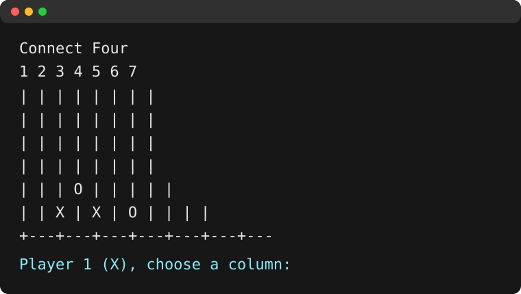

# Python Terminal Projects

A collection of small Python projects for practicing games, calculators,
file-backed utilities, APIs, and desktop interfaces. Most programs are
standalone scripts and are intentionally simple to read and run.

> **Security notice:** The OpenWeather key that was previously committed has
> been removed from the working tree. Treat it as compromised: revoke it in
> the OpenWeather account and create a replacement key before using the weather
> app. The application now reads `OPENWEATHER_API_KEY` from the environment.

## Contents

- [Setup](#setup)
- [Run commands](#run-commands)
- [Project index](#project-index)
- [Dependencies](#dependencies)
- [Screenshots](#screenshots)
- [Demo data](#demo-data)
- [Repository layout](#repository-layout)

## Setup

1. Install Python 3.10 or newer.
2. Create and activate a virtual environment:

   ```powershell
   py -m venv .venv
   .\.venv\Scripts\Activate.ps1
   ```

3. Install the optional third-party dependencies:

   ```powershell
   python -m pip install -r requirements.txt
   ```

4. For the weather app, copy `.env.example` to `.env` or set the variable in
   your shell. Do not commit a real key:

   ```powershell
   $env:OPENWEATHER_API_KEY = "replace-with-your-new-key"
   ```

   The app loads a root-level `.env` file automatically. The shell variable,
   when set, takes precedence over the `.env` value.

## Run commands

Run a script from this directory with:

```powershell
python ".\games\CONNECT FOUR.py"
python .\games\Guess_My_Number.py
python .\gui_apps\Weather_Api_App.py
```

Use the same pattern for any project in the index below. GUI applications
open a desktop window. Terminal applications wait for input in the console.
File-backed applications read and write their neighboring JSON or CSV demo
files.

## Project index

### Games and interactive fiction

| Project | Run |
| --- | --- |
| Battleship | `python .\games\BATTLESHIP.py` |
| Baby Blackjack | `python .\games\Baby_Blackjack.py` |
| Blackjack | `python .\games\Blackjack.py` |
| Connect Four | `python ".\games\CONNECT FOUR.py"` |
| Guess My Number | `python .\games\Guess_My_Number.py` |
| Hangman | `python .\games\Hangman.py` |
| Quiz Game | `python .\games\Quiz_Game.py` |
| Rock Paper Scissors | `python .\games\Rock_Paper_Scissors.py` |
| Rock Paper Scissors Lizard Spock | `python .\games\Rock_Paper_Scissors_Lizard_Spock.py` |
| Text-Based Adventure | `python .\games\Text-Based_Adventure.py` |
| Tic-Tac-Toe | `python .\games\TIC-TAC-TOE.py` |
| Truth or Dare | `python .\games\Truth_or_Dare.py` |
| Who Wants to Be a Millionaire | `python .\games\Who_Wants_to_Be_a_Millionaire.py` |

### Utilities and calculators

| Project | Run |
| --- | --- |
| Area Calculator | `python .\utilities\Area_Calculator.py` |
| Caesar Cipher | `python .\utilities\Caesar_Cipher.py` |
| Chatbot | `python .\utilities\Chatbot.py` |
| Dice Rolling Simulator | `python .\utilities\Dice_Rolling_Simulator.py` |
| Fortune Cookies | `python .\utilities\Fortune_Cookies.py` |
| Horoscope | `python .\utilities\Horoscope.py` |
| Leap Year | `python .\utilities\Leap_Year.py` |
| Metric Conversion Tool | `python .\utilities\Metric_Conversion_Tool.py` |
| Morse Code Translator | `python .\utilities\Morse_Code_Translator.py` |
| NYC MetroCard Calculator | `python .\utilities\NYC_MetroCard_Calculator.py` |
| Pokédex | `python ".\utilities\Pokédex.py"` |
| Roman Numeral Converter | `python .\utilities\Roman_Numeral_Converter.py` |
| Word Counter | `python .\utilities\Word_Counter.py` |

### Productivity and file-backed apps

| Project | Run |
| --- | --- |
| Bank Account | `python .\productivity\Bank_Account1.py` |
| Class Schedule | `python .\productivity\Class_Schedule.py` |
| Contact Book | `python .\productivity\Contact_Book.py` |
| Expense Tracker | `python .\productivity\Expense_Tracker.py` |
| Faves List | `python .\productivity\Faves_List.py` |
| Grocery App | `python .\productivity\Grocery_App.py` |
| Library Management System | `python .\productivity\Library_Management_System.py` |
| Recipe Book | `python .\productivity\Recipe_Book.py` |
| To-Do Lists | `python .\productivity\To-Do_Lists.py` |

### API and desktop apps

| Project | Run |
| --- | --- |
| Digital Clock | `python .\gui_apps\DigitalClock.py` |
| Stop Clock | `python .\gui_apps\StopClock.py` |
| Weather API App | `python .\gui_apps\Weather_Api_App.py` |

## Dependencies

- Python standard library: used by most projects.
- `requests`: required by `utilities/Pokédex.py` and `gui_apps/Weather_Api_App.py`.
- `PyQt5`: required by the weather app, digital clock, and stop clock in `gui_apps/`.
- Tkinter: required by Battleship and normally included with desktop Python
  installations.

Install the third-party packages with `python -m pip install -r
requirements.txt`.

## Screenshots

The [screenshots](./screenshots/) directory contains representative previews.
The projects are intentionally small and interactive, so additional captures
can be added after choosing representative demo inputs.

| Project | Preview |
| --- | --- |
| Connect Four | [](./screenshots/connect-four.svg) |
| Digital Clock | [](./screenshots/Digital%20Clock.png) |
| Weather App | [](./screenshots/Weather%20app.png) |

Click a preview to open the full-size image. The Connect Four preview is a
repository-safe illustration; the Digital Clock and Weather App images are
captured application screenshots. No personal screenshots or user data belong
here.

## Demo data

The JSON and CSV files in `productivity/` and `utilities/` are fictional
starter data for the file-backed exercises. They use names such as “Alex
Example”, placeholder phone numbers from the `555-0100` range, and small demo
amounts. Replace them locally when experimenting, but do not add real
contact, financial, or account information to source control.

## Repository layout

```text
Python_Terminal_Projects/
├── README.md
├── requirements.txt
├── .env.example
├── .gitignore
├── games/
├── utilities/
├── productivity/
├── gui_apps/
└── screenshots/
```

Scripts and their supporting data now live in the category that owns them.
